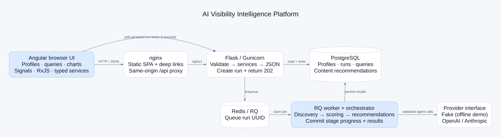
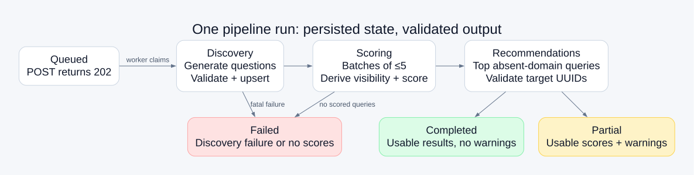

# How the platform works

About ten minutes to read, including the diagrams. Start with the [recorded product tour](media/platform-walkthrough.mp4), or use the [chaptered player](demo/index.html). The [Loom narration](LOOM_SCRIPT.md) is a separate ten-minute presentation script.

The recording uses a separate Docker project, a fresh PostgreSQL database, and the deterministic fake provider. Its 12 queries, 3 recommendations, and 750-token summary are results returned by that backend. They are not evidence that a live OpenAI or Anthropic request succeeded. No provider credentials appear in the recording.

## 1. The question the product answers

A business owner wants to know which questions could lead people to their product, where the business is missing from an AI-style answer, and what content to publish next. The platform organizes that investigation into a repeatable workflow: describe a business, run three agents, inspect scored questions, and review content recommendations.

The distinction between measurement and estimation matters throughout. Search volume and competitive difficulty are model estimates. Visibility comes from a simulated answer's ordered list of cited domains. Even a live provider does not turn this into an audit of actual ChatGPT traffic or a keyword-volume database. The UI labels those limitations next to the table.

## 2. Follow the product flow

Use the recording for the continuous flow. The [ordered screenshot index](screenshots/README.md) provides still frames for each step.

**Dashboard → create profile.** The dashboard shows profile count, discovered-query count, average opportunity score, recent runs, and profile links. On an empty database, totals are zero and the average is a dash. Add a business profile to begin. Name, bare domain, and industry are required. Description is optional. Competitors become removable chips, with validation, deduplication, and a ten-domain limit. A URL such as `https://surferseo.com` is rejected because this field stores a hostname.

**Profile → run pipeline.** Creating the profile makes a real API request and opens its detail view. Before the first run, each child view has an empty state. Run pipeline queues work and disables duplicate starts. Progress shows the persisted stage and scored/discovered counts. After completion, a summary shows query counts, recommendations, tokens, and duration. The fake provider finishes quickly; a real model can take longer than the recording.

**Queries → narrow the work.** The table combines question text, estimated demand, difficulty, opportunity score, and visibility. Sorting, pagination, minimum score, and visibility filtering happen through server parameters. Those parameters are reflected in the URL. A minimum score of zero means no score restriction, so unknown rows are not accidentally excluded. Numbers align in columns; color chips also show their numeric value or an explicit unknown state.

Recheck scores one question and replaces its row after a successful response. It is a separate provider operation, not a new full pipeline. Export CSV follows every filtered page at 100 records per request before creating a file; it does not export only the visible page. The exporter quotes commas, quotes, and line breaks, adds a UTF-8 BOM, and guards spreadsheet formula prefixes. A failed later page produces no misleading partial download.

**Chart → recommendations → return.** The chart orders questions by opportunity, with orange for absent and blue for visible. Unknown visibility has a neutral color; a null score has no invented zero-height result. Full questions are available in tooltips and an accessible table. At tablet widths the bars become horizontal. Recommendations explain content type, priority, rationale, target question, and keywords. Priority counts remain visible when a filter has no matches. A back arrow returns to the dashboard from the shared profile screen, regardless of which dashboard section opened it.

## 3. Read the architecture from left to right



The browser runs a standalone Angular application. Production nginx serves its static files, returns the SPA entry point for deep links, compresses responses, and gives hashed assets a long cache lifetime. Requests under `/api/` go to Flask over Docker's internal network. The browser therefore uses one origin for UI and API traffic; Compose does not need a cross-origin browser setup.

Gunicorn runs the Flask API. PostgreSQL stores business profiles, pipeline runs, discovered questions, and content recommendations. Redis carries RQ jobs. A worker receives a run UUID, claims the persisted run, invokes the orchestrator, and writes progress and results back to PostgreSQL. Redis is the delivery mechanism; the browser reads application state from the API and database rather than subscribing directly to a worker.

This separation keeps long pipeline work outside an HTTP request. It also lets API processes and workers scale independently. More workers increase provider concurrency and database activity, so scaling should account for rate limits and cost. The current project establishes those boundaries without claiming a production scheduler, tenant system, or operational control plane.

## 4. Frontend: from an interaction to stable state

Feature components use OnPush change detection, signals for rendered state, and typed services for network requests. Components do not inject HttpClient. Models retain the OpenAPI field names and nullability, which avoids a second translation layer between Python responses and TypeScript views. Tests replace HTTP using HttpTestingController instead of requiring the backend or a model account.

The profile form uses Reactive Forms. Local validation gives immediate feedback; backend 422 field errors still remain authoritative and appear beside the relevant controls. A pending submission prevents duplicate requests. The global interceptor maps transport and API failures into a common AppError and emits an error toast, while the view provides a useful retry action.

A profile-scoped store owns profile metadata, the current run, progress, and the revision that refreshes child views. Polling starts immediately and repeats every two seconds while the run is queued or running. It includes the terminal response before stopping. Leaving the profile cancels the subscription and in-flight request. Reloading an active profile resumes its existing latest run instead of starting another one.

The dashboard has a bounded memory snapshot for quick return navigation. Within 30 seconds, a fresh snapshot avoids another pair of overview requests. Successful creation, run start, terminal polling, or recheck invalidates that snapshot. An expired overview refreshes on entry while the previous content remains visible. This is a small navigation cache, not a general query cache or a live dashboard subscription.

Query controls debounce changes and compare normalized state, so equivalent URLs do not trigger redundant fetches. Filter-only navigation skips a full-page View Transition. Actual route changes keep a short transition, and reduced-motion users skip it. This keeps dropdown changes and pagination from looking like page reloads.

Tailwind utilities map to light/dark tokens. Inter and ng-icons assets are local. CDK handles the small-screen drawer and focus management. Cloudlet supplies notifications through a small lazy Angular/React adapter; the feature views remain Angular. Borderless native dropdowns keep their keyboard behavior and visible focus indication.

## 5. Backend: contracts, agents, and persistence

Flask uses an app factory, blueprints, service operations, SQLAlchemy models, and Alembic migrations. Routes validate and delegate. Database changes belong to services and the orchestrator. Agents take plain inputs and return validated outputs; they do not receive database sessions or ORM rows. This makes prompts and failure handling testable without a running web server.



**Discovery** asks for varied questions across informational, comparison, transactional, and navigational intent. The prompt requests 10–20 questions; validation deduplicates and bounds the result. The orchestrator upserts questions by profile and normalized text. Reruns can update existing rows rather than creating duplicates. Run metadata is historical, but the question collection is not an immutable archive of every run's answer.

**Scoring** processes at most five questions per batch with a configured concurrency cap. The provider estimates volume, difficulty, and an ordered domain list. Code derives whether the target domain appears and its one-based position. Hostname matching understands subdomains and avoids matching a lookalike suffix. The main worker thread writes results and updates counters after completed batches; concurrent provider threads do not use Flask context or database sessions.

**Recommendations** select the highest-opportunity scored questions where the business is absent. The agent proposes content with validated type, priority, rationale, and keywords. Target UUIDs must belong to the supplied questions. Unknown targets are dropped. A failed recommendation stage preserves the previous set; a validated replacement is persisted together. If all scored questions are visible, the stage can clear obsolete recommendations and skip the provider call.

All agents extract a balanced JSON object and validate it with Pydantic. Invalid output receives one repair attempt. That repair is distinct from bounded retries for transient provider failures such as rate limiting, server errors, or timeouts. An invalid credential should be corrected rather than repeatedly retried. The fake client follows the same agent path, with deterministic output and injectable failures for tests.

## 6. Why one question outranks another

The score is a ranking heuristic, calculated in code rather than accepted from an LLM:

```text
volume_norm = min(1, log10(1 + volume) / log10(100001))
ease = 1 - difficulty / 100
score = round(clamp(0.40 × volume_norm + 0.25 × ease + 0.35 × gap, 0, 1), 3)
```

For an absent business, `gap = 0.5 + 0.5 × competitors_cited / max(1, competitor_count)`. For a visible business, gap represents limited ranking headroom: `min(0.3, 0.1 × (position - 1))`. Unknown visibility uses 0.5. Missing volume or difficulty produces a null score.

For example, volume 100,000, difficulty 20, an absent target, and one of two competitors cited give normalized demand 1, ease 0.8, and gap 0.75. The weighted result is 0.8625, displayed as **0.863**. These weights are explicit product choices, not a statistically calibrated probability of winning a citation. Original estimates and score components support explanation and future recalibration.

## 7. Completion, failure, and recovery

The API returns 202 for a newly queued run. An active run for the same profile causes 409. A database constraint closes races across API processes, and an atomic worker claim prevents duplicate delivery from executing the same queued run twice. Those safeguards do not make every later POST idempotent: after a terminal run, a deliberate new request starts another run.

A run is completed when its work succeeds, partial when useful scores coexist with stage warnings, and failed when discovery fails or no queries can be scored. Unknown values remain unknown. Terminal run status and profile status are separate: the profile enum has no partial value, so inspect the latest run for its complete outcome.

The startup stale-run sweep marks sufficiently old queued/running rows failed. It is not a continuous watchdog. Persisted stages and counters help diagnose interruption; repeating the seed command does not replace an already successful or active demo run. Starting a new pipeline is the explicit way to obtain new results after changing providers.

## 8. Run it, verify it, and recognize its limits

Follow the root [quick start](../readme.md#quick-start). Choose fake for a reproducible offline demonstration. A live provider is configured in the backend's ignored `.env`, then API, worker, and frontend containers are recreated. Recreating the frontend refreshes its nginx upstream connection after API container replacement. Keys do not belong in the frontend bundle, screenshots, or recording.

If a run fails immediately, inspect its stored stage and the worker log. `401 invalid_api_key` means OpenAI rejected authentication, even if a value is present in the environment. A model-access error requires checking an enabled model and API compatibility. The current UI can show a generic failure message; the stage and sanitized provider status are more useful for diagnosis than a successful container health check. Readiness confirms local dependencies, not provider credentials or account quota.

Frontend verification covers strict builds, lint, HTTP contracts, polling cancellation, cache invalidation, filters, CSV, and controls. Backend tests cover APIs, schemas, score ordering, agents, failures, concurrency, and OpenAPI conformance. Local evidence records 137 frontend tests and 180 backend tests with 97.62% backend coverage; the reports identify who ran them. Hosted CI definitions exist, but a local pass is not proof that a GitHub Actions run has executed.

Authentication, tenant isolation, live assistant-answer sampling, and a commercial search-volume source remain outside this assessment. The demo database has no published port and uses internal trust; a deployed system needs an authenticated database and deployment secrets. A useful next step is to replace the estimation inputs with measured sources while retaining the contracts, queue boundary, and explicit unknown/failure states shown here.
