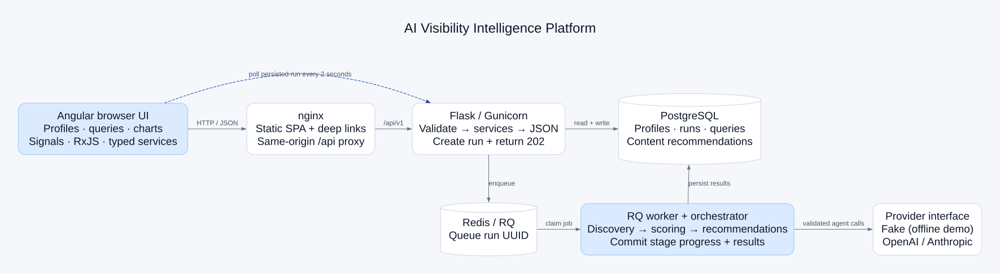
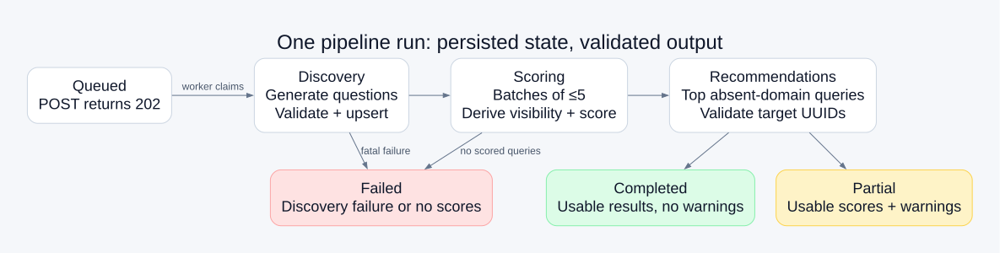

# Architecture diagrams

These diagrams describe the implemented system. The SVGs work without a diagram plugin; DOT source is included for editing. See the [ten-minute guide](../WALKTHROUGH.md) for the detailed explanation.

## System boundary



Angular renders typed API data. nginx serves the SPA and proxies same-origin `/api/v1` requests. Flask validates and persists through service operations. Redis/RQ delivers a run identifier to a worker. The worker's orchestrator invokes validated agents and commits progress to PostgreSQL. Only the provider adapter talks to OpenAI, Anthropic, or the offline fake client.

The dashed polling arrow is a logical browser-to-API relationship: those HTTP requests still pass through nginx. The diagram does not imply direct browser access to Docker-internal API, Redis, worker, or database ports.

## Pipeline lifecycle



Discovery, scoring, and recommendations are stage values on a run. A queued run is claimed before discovery. Completed means a successful workflow; partial preserves useful results with warnings; failed includes discovery failure or no scored questions. Unexpected orchestration errors can also fail a run from later stages. A profile's enum has no partial status, so its latest run is the source of that distinction.

| Persisted object       | Responsibility                                                             |
| ---------------------- | -------------------------------------------------------------------------- |
| Business profile       | Normalized domain, industry, description and competitors                   |
| Pipeline run           | Stage, status, timestamps, counters, tokens and error summary              |
| Discovered query       | Question, estimates, derived visibility, score and latest run association  |
| Content recommendation | Profile/run/query reference, type, priority, title, rationale and keywords |

Reruns upsert questions within a profile; they do not create an immutable per-run snapshot of every answer. A successful recommendation replacement and its target references are validated before persistence.

## Update the drawings

With Graphviz installed, run from the repository root:

```sh
dot -Tsvg docs/diagrams/architecture.dot -o docs/diagrams/architecture.svg
dot -Tsvg docs/diagrams/pipeline.dot -o docs/diagrams/pipeline.svg
```

The supplied SVGs were rendered from these sources using the Graphviz WebAssembly build. No external image service or provider key was used.
