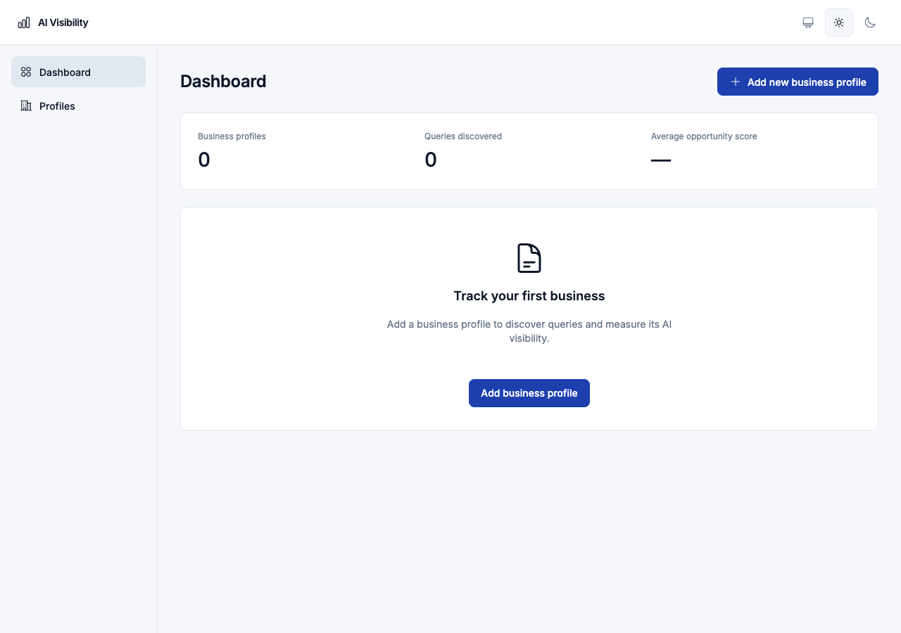
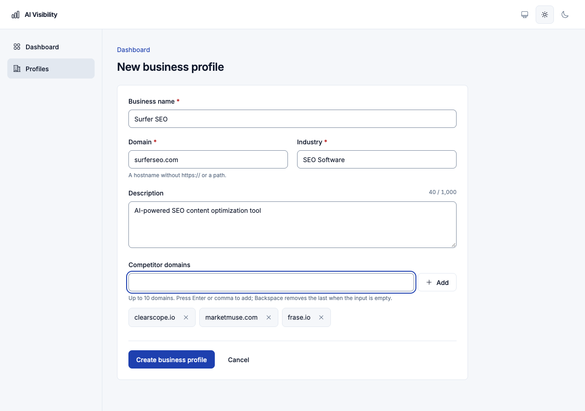
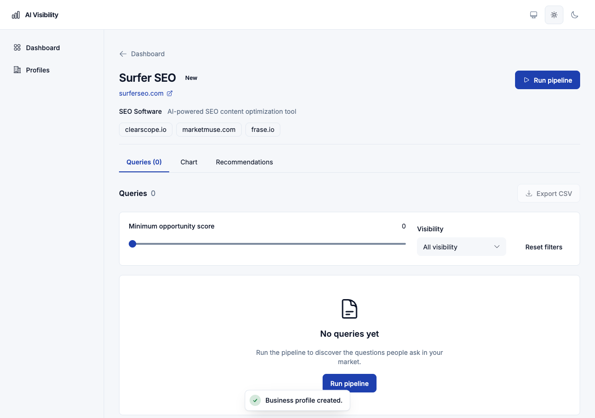
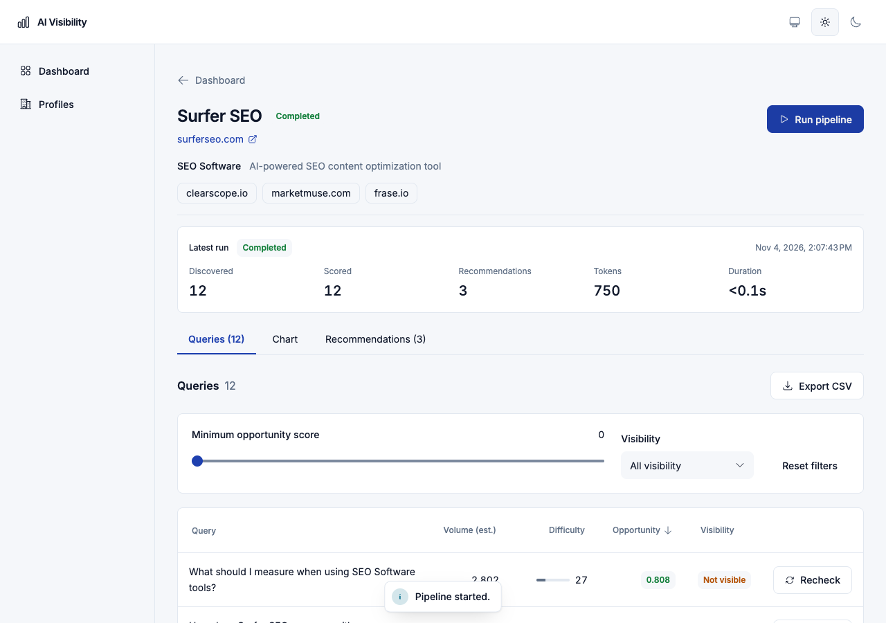
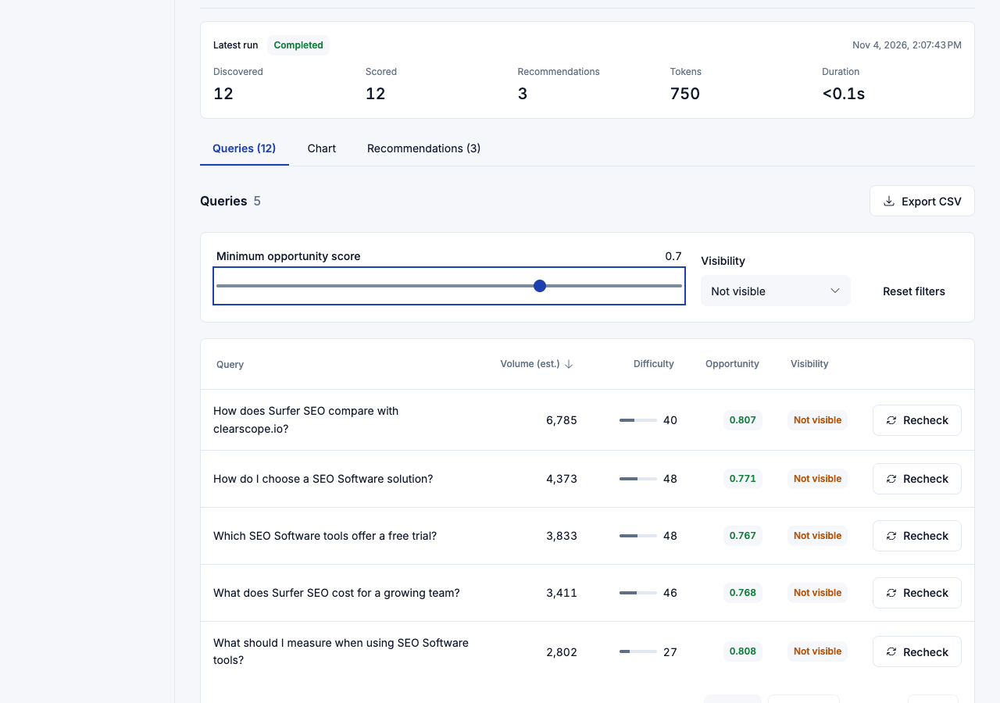
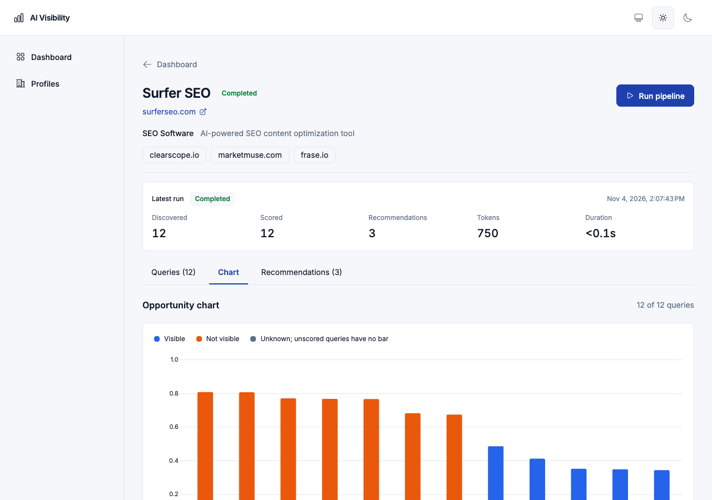
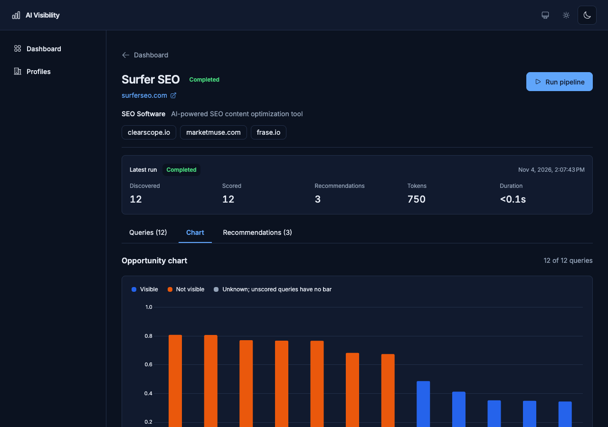
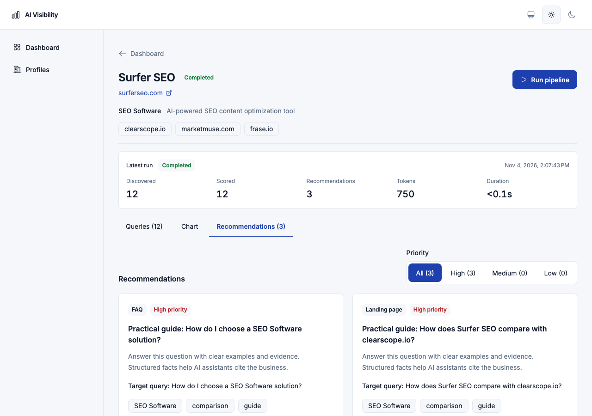
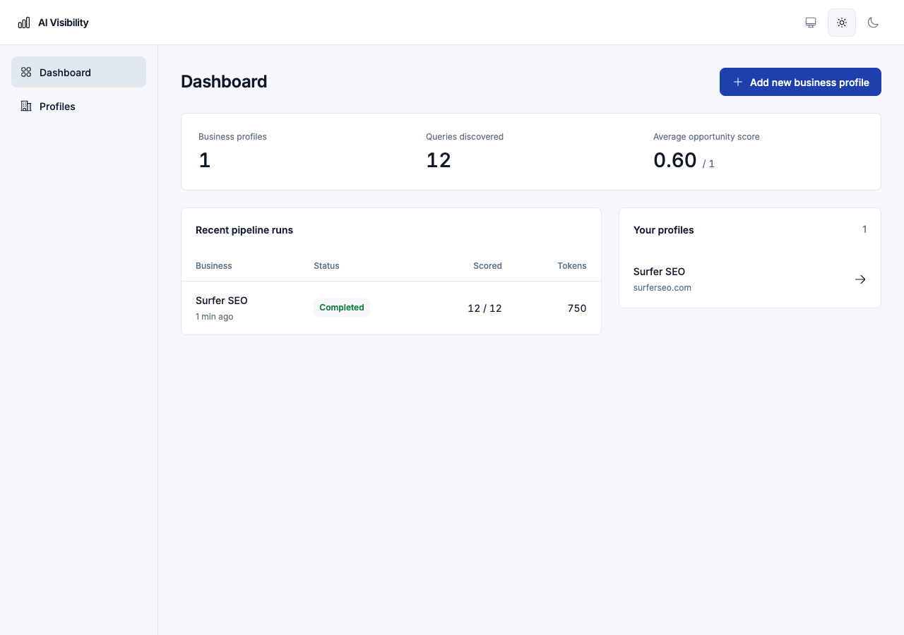
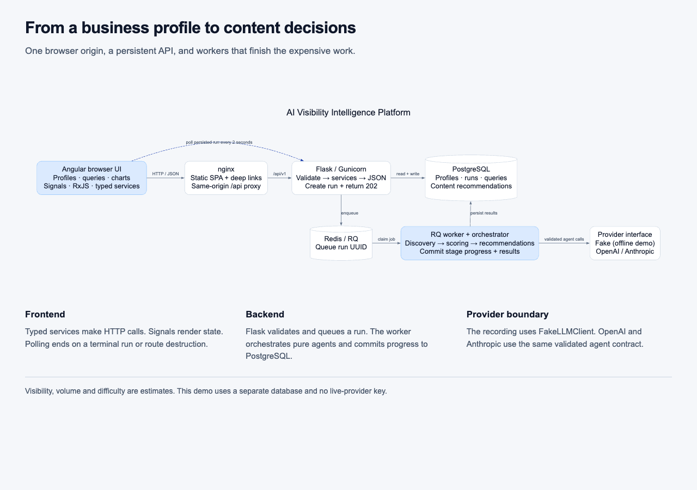

# Product flow in still frames

The [continuous recording](../media/platform-walkthrough.mp4) is the primary walkthrough. These images are the accessible still-frame alternative, captured during the same isolated fake-provider session. Use the [player](../demo/index.html) for chapters and captions. No app business data was mocked in the browser.

| Order | Screen                                               | What to look for                                                    |
| ----- | ---------------------------------------------------- | ------------------------------------------------------------------- |
| 1     | [Empty dashboard](01-dashboard-empty.png)            | Zero totals and the first-profile action                            |
| 2     | [Validated profile form](02-profile-form.png)        | Bare domain, required fields and three competitor chips             |
| 3     | [Profile before its first run](03-profile-ready.png) | Explicit Run pipeline action and empty queries                      |
| 4     | [Completed query table](04-queries-light.png)        | Persisted run summary, score chips, estimated volume and visibility |
| 5     | [Filtered opportunities](05-filtered-queries.png)    | Server-backed minimum score and missing-visibility filters          |
| 6     | [Opportunity chart](06-opportunity-chart.png)        | Scores from zero to one, with blue/orange visibility encoding       |
| 7     | [Dark chart](07-chart-dark.png)                      | Live theme updates for chart axes and surrounding controls          |
| 8     | [Content recommendations](08-recommendations.png)    | Priority, rationale, target question and keywords                   |
| 9     | [Populated dashboard](09-dashboard-results.png)      | Aggregates and a completed run, plus profile navigation             |
| 10    | [Architecture view](10-architecture.png)             | Browser, proxy, API, queue, worker, database and provider boundary  |

## Empty dashboard → profile → run

## Results → investigation → recommendations

## Return → understand the system

The unnumbered images in this directory are earlier engineering review captures. The numbered set above is the current documentation flow.
