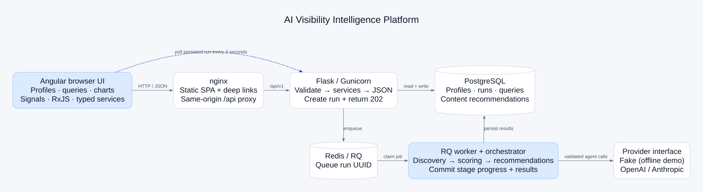

# AI Visibility Intelligence Platform

Discover the questions people ask AI assistants, assess a business's visibility, and prioritize content opportunities. The Angular dashboard connects to a Flask API whose three-agent pipeline discovers queries, estimates visibility, and recommends content.

A fresh checkout uses a deterministic fake provider and runs without an API key. An existing `backend/.env` can select a live provider; copying the root port settings does not reset it. Query volume, competitive difficulty, and AI-answer visibility are **estimates**, not live search or ChatGPT measurements.

## Watch the workflow

<video controls playsinline preload="metadata" width="960" style="max-width:100%;height:auto;" poster="docs/screenshots/09-dashboard-results.png" aria-label="AI Visibility product walkthrough with narration">
  <source src="docs/media/platform-walkthrough.mp4" type="video/mp4" />
  <track kind="captions" src="docs/media/voiceover.vtt" srclang="en" label="English narration" />
  <a href="docs/media/platform-walkthrough.mp4">Watch or download the narrated MP4</a>.
</video>

[Watch or download the narrated MP4](docs/media/platform-walkthrough.mp4) · [Open the chaptered player](docs/demo/index.html)

The recording follows a real browser through an isolated fake-provider stack: empty dashboard → profile validation → queued pipeline → queries and filters → recheck/export → chart/themes → recommendations → architecture. It uses a separate database and no live API key. The 1:51 video includes the supplied voiceover, on-screen captions and nine chapters. Screen timings follow the narration; the original voice speed and pitch are preserved.

Inline playback depends on the Markdown viewer. Use the direct MP4 link or chaptered player if the embedded controls are unavailable. Open `docs/demo/index.html` directly, or serve the player with nginx for reliable chapter seeking:

```sh
docker run --rm -p 127.0.0.1:8000:80 \
  --mount "type=bind,source=$PWD/docs,target=/usr/share/nginx/html,readonly" nginx:alpine
# Open http://localhost:8000/demo/
```

| Read or view                                                                      | Purpose                                                                               |
| --------------------------------------------------------------------------------- | ------------------------------------------------------------------------------------- |
| [Ten-minute technical walkthrough](docs/WALKTHROUGH.md)                           | How frontend state, API contracts, workers, agents, scoring and recovery fit together |
| [Architecture and pipeline diagrams](docs/diagrams/README.md)                     | System boundaries and persisted run lifecycle                                         |
| [Ordered still frames](docs/screenshots/README.md)                                | An accessible step-by-step alternative to the recording                               |
| [Backend reference](backend/README.md) / [frontend reference](frontend/README.md) | Setup, implementation and verification detail                                         |

## Quick start

Requires Docker with Compose v2.24+ and available host ports 4200 and 5000. From the repository root:

```sh
cp .env.example .env
docker compose up --build -d --wait
curl --fail http://localhost:4200/api/v1/health
```

Open [the dashboard](http://localhost:4200). Add a business profile, select **Run pipeline**, then open Queries, Chart, and Recommendations. The UI and `/api/v1` share the frontend origin through nginx; browser API requests need no CORS configuration in Compose.

To seed the assessment's example instead of entering a profile:

```sh
docker compose exec api flask seed-demo --run
```

Data persists in a named PostgreSQL volume. `docker compose down` stops containers without deleting it. Root `.env` can change `FRONTEND_PORT` or `API_PORT` if a host port is occupied. On macOS, AirPlay may own IPv6 `localhost:5000`; use `127.0.0.1:5000` for direct API calls. The UI proxy connects to the API over Docker's internal network.

## Local development

Python 3.12 and [Node 26 LTS](https://github.com/nodejs/Release#release-schedule) are used in CI. Angular also supports Node 22.22.3+ and 24.15+.

Backend, from `backend/`:

```sh
python3.12 -m venv .venv
source .venv/bin/activate
pip install -r requirements-dev.txt
cp .env.example .env
flask --app wsgi db upgrade
flask --app wsgi run --host 127.0.0.1 --port 5000
```

The local `.env.example` defaults to SQLite, fake provider, and eager execution; it does not require Redis. If port 5000 is occupied, use `--port 5016` and pass the matching proxy target to the frontend. Queue execution requires Redis, `PIPELINE_EXECUTION=queue`, and a worker in a separate terminal:

```sh
cd backend
source .venv/bin/activate
python worker.py
```

Frontend, in a separate terminal:

```sh
cd frontend
npm install
npm run start:proxy
```

Open [localhost:4200](http://localhost:4200). The proxy configuration targets IPv4 `http://127.0.0.1:5000`; override it with `API_PROXY_TARGET=http://127.0.0.1:5016 npm run start:proxy` when needed. All UI data comes from the API. The standard `npm start` / `npx ng serve` command is also available and uses `environment.ts` with `http://localhost:5000`; it requires the backend to allow the frontend's origin and a working localhost port 5000.

The production build replaces the environment with a same-origin URL; nginx proxies `/api/` to `api:5000` and falls back to `index.html` for deep links.

## Configuration

Root `.env.example` lists Compose host ports. Copy `backend/.env.example` to `backend/.env` for provider/model settings; Compose loads it if present. Keep usable credentials only in the ignored `.env` files or your deployment's secret manager.

| Setting                                                    | Default                                                | Purpose                                                              |
| ---------------------------------------------------------- | ------------------------------------------------------ | -------------------------------------------------------------------- |
| `FRONTEND_PORT` (root)                                     | `4200`                                                 | Browser entry point                                                  |
| `API_PORT` (root)                                          | `5000`                                                 | Direct API IPv4 loopback port                                        |
| `FLASK_APP` / `FLASK_ENV`                                  | `wsgi:app` / local `development`, Compose `production` | CLI application and runtime mode                                     |
| `SECRET_KEY`                                               | empty                                                  | Optional local Flask secret; provide a deployment secret when needed |
| `LLM_PROVIDER`                                             | `fake`                                                 | `fake`, `anthropic`, or `openai`                                     |
| `ANTHROPIC_API_KEY` / `OPENAI_API_KEY`                     | empty                                                  | Key for the selected live provider                                   |
| `DISCOVERY_MODEL`, `SCORING_MODEL`, `RECOMMENDATION_MODEL` | provider defaults                                      | Per-agent model overrides                                            |
| `DATABASE_URL`                                             | local SQLite / Compose PostgreSQL                      | Persistence; Compose overrides the local value                       |
| `REDIS_URL`                                                | local empty / Compose Redis                            | Queue connection; Compose overrides the local value                  |
| `PIPELINE_EXECUTION`                                       | local `eager` / Compose `queue`                        | Inline or worker execution                                           |
| `SCORING_CONCURRENCY`                                      | `4`                                                    | Maximum parallel scoring batches                                     |
| `RECOMMENDATION_TOP_N`                                     | `8`                                                    | Highest-opportunity missing queries considered                       |
| `RUN_STALE_MINUTES` / `JOB_TIMEOUT_SECONDS`                | `30` / `900`                                           | Recovery and worker timeout limits                                   |
| `LLM_TIMEOUT_SECONDS` / `LLM_MAX_ATTEMPTS`                 | `45` / `3`                                             | Provider timeout and transient retry cap                             |
| `LLM_RETRY_MIN_SECONDS` / `LLM_RETRY_MAX_SECONDS`          | `1` / `8`                                              | Transient retry backoff bounds                                       |
| `CORS_ORIGINS`                                             | `http://localhost:4200`                                | Allowed origins for direct local API calls                           |
| `API_PROXY_TARGET` (frontend process)                      | `http://127.0.0.1:5000`                                | Optional local development proxy target                              |
| `environment.ts.apiUrl`                                    | `http://localhost:5000`                                | Direct development API URL                                           |
| `environment.prod.ts.apiUrl`                               | empty                                                  | Production same-origin API URL                                       |

For Anthropic, set `LLM_PROVIDER=anthropic` and `ANTHROPIC_API_KEY` in `backend/.env`; for OpenAI, set `LLM_PROVIDER=openai` and `OPENAI_API_KEY`. Recreate API/worker containers after changes with `docker compose up -d --force-recreate api worker frontend`. See the [backend README](backend/README.md) for provider defaults, retries, agent prompts, and all configuration options.

### When a live run fails

A healthy local API does not verify provider credentials. Check the latest run's stage, then `docker compose logs --tail=100 worker`. An OpenAI `401 invalid_api_key` means authentication was rejected: replace the key, recreate API/worker/frontend, and start a **new** pipeline run. Missing model access or incompatible generation parameters need a model enabled for the selected adapter/account. Keep environment files off screen when recording. The fake provider is explicit; a failed live call does not silently switch to demo output.

## Architecture



The browser reads persisted state through **Angular → nginx → Flask → PostgreSQL**. Starting a pipeline adds **Redis → RQ worker → provider** to that flow. The worker orchestrates three pure agents and commits progress/results; the API returns a queued snapshot with HTTP 202. The frontend polls the run until it reaches a terminal state. Recheck is a separate synchronous request for one question.

Frontend components use strict models, OnPush, signals and typed HTTP services. Reactive Forms validate input; the profile store owns polling and child-view refresh. A bounded 30-second dashboard snapshot avoids repeated requests when navigating back, with invalidation after successful data changes. Equivalent filters do not refetch, and query-only navigation skips full-page animation. Light/dark/system tokens, local ng-icons, CDK focus management and the lazy Cloudlet adapter support the UI.

Backend blueprints delegate to services. Agents use plain inputs and validated Pydantic outputs; the orchestrator alone owns database writes. Scoring is batched with bounded provider concurrency. JSON repair and transport retries are separate. Active-run constraints, atomic worker claims and startup stale-run recovery cover different failure cases; they are explained in the [technical walkthrough](docs/WALKTHROUGH.md).

## API

| Method     | Endpoint                                  | Purpose                                                    |
| ---------- | ----------------------------------------- | ---------------------------------------------------------- |
| GET        | `/api/v1/health`                          | Dependency readiness                                       |
| GET        | `/api/v1/dashboard`                       | Totals and recent runs                                     |
| GET / POST | `/api/v1/profiles`                        | Paginated profiles / create profile                        |
| GET        | `/api/v1/profiles/{uuid}`                 | Profile and latest run                                     |
| POST       | `/api/v1/profiles/{uuid}/run`             | Queue a run, return 202; 409 if already active             |
| GET        | `/api/v1/profiles/{uuid}/runs`            | Run history                                                |
| GET        | `/api/v1/runs/{uuid}`                     | Poll queued/running/terminal state                         |
| GET        | `/api/v1/profiles/{uuid}/queries`         | Score/visibility filters, pagination, sorting              |
| GET        | `/api/v1/profiles/{uuid}/recommendations` | Content recommendations and optional priority filter       |
| POST       | `/api/v1/queries/{uuid}/recheck`          | Re-score one query; leave it unchanged on upstream failure |

## Opportunity score

The score combines normalized demand, ease of competition, and the visibility gap:

```text
score = clamp(0.40 × log-normalized volume + 0.25 × ease + 0.35 × gap, 0, 1)
ease = 1 - difficulty / 100
```

The gap incorporates competitor citations when the business is absent, and ranking headroom when it is already visible. Missing volume/difficulty produces a null score. The [backend README](backend/README.md) contains the complete formula, a worked example, and test-backed tradeoffs.

## Dashboard features

- Overview totals, recent pipeline runs, and profile navigation.
- Validated profile creation with competitor chips and field-level server errors.
- Pipeline stages, progress, recovery after reload, partial/failure messages, and run summaries.
- URL-backed query filters, server pagination/sorting, threshold chips, and row-level rechecks.
- Theme-aware opportunity bars with full-text tooltips and an accessible data-table fallback.
- Recommendation cards with priority counts and filtering.
- Light/dark/system themes, keyboard navigation, reduced-motion route transitions, skeletons and retry states.
- CSV export fetches **all filtered pages**, reports progress, quotes RFC 4180 cells, and guards spreadsheet formula injection. It includes a UTF-8 BOM. Unscored values remain empty rather than becoming zero.

## Tests and CI

Frontend, from `frontend/`:

```sh
npm ci
npm run lint
npm test -- --watch=false --browsers=ChromeHeadless
npm run build -- --configuration production
```

Set `CHROME_BIN` if Chromium/Chrome is not on its usual path. On macOS: `CHROME_BIN='/Applications/Google Chrome.app/Contents/MacOS/Google Chrome'`. Jasmine/Karma is the only runner. API tests use `HttpTestingController`; component/store tests keep fixtures in spec files. No frontend test calls a real model.

Backend, from `backend/` with its virtual environment active:

```sh
ruff check .
ruff format --check .
LLM_PROVIDER=fake FLASK_ENV=testing pytest --cov=app --cov-fail-under=85
```

Against the running full stack:

```sh
BASE_URL=http://127.0.0.1:4200 bash backend/scripts/smoke.sh
docker compose config --quiet
```

GitHub Actions definitions cover backend lint/tests/coverage and Docker build, frontend lint/tests/production and Docker builds, and a complete Compose startup plus smoke test through nginx. Hosted Actions execute when the Director pushes; local evidence is summarized in the [technical guide](docs/WALKTHROUGH.md), with detailed engineering reports in the workspace’s `Context/reports/` directory.

## Documentation and recording

The [player](docs/demo/index.html) includes chapters, the video, diagrams and optional still frames. The [media notes](docs/media/README.md) record the provider, fixture, duration and recording process. The [screenshot index](docs/screenshots/README.md) follows the same order as the product flow; images come from the recorded API-backed session.

The recording is a successful offline demonstration. It does not establish live-provider authentication, model access or production accuracy. Existing data and credentials in the main Docker stack were not used or reset.

## Project structure

```text
backend/          Flask API, agents, provider adapters, worker, migrations, tests
frontend/         Angular dashboard, reusable controls, services, tests, nginx image
docs/             Product video/player, ten-minute guide, narration, diagrams and still frames
Context/          Local assessment, contract, planning and engineering reports
.github/workflows Backend, frontend and Compose CI
```

## Tradeoffs and limitations

Visibility, search volume and difficulty are model estimates. The fake provider is deterministic for offline demos; a live provider still simulates answer visibility. Production accuracy would require real answer sampling and a search-volume source such as DataForSEO, plus monitoring of provider/model changes.

Authentication and tenant isolation are outside the assessment scope. The Docker database uses trust on an unpublished local network for the demo; a deployed system should supply its authenticated database URL. API/worker containers scale independently. The short dashboard navigation cache is implemented; broader query caching and ETags remain future work. The chart intentionally shows the top 100 queries, with that limit stated in the UI; CSV export fetches every filtered page.

The local chart adapts to tablet width using horizontal bars. Notification rendering adds React only inside the requested Cloudlet adapter. Route animation uses Angular Router's current View Transitions support instead of the deprecated `@angular/animations` package; unsupported browsers navigate without animation, and reduced-motion users skip transitions.

## AI tools used

Claude Code acts as the planning/review Lead. OpenAI Codex acts as the implementation Engineer. The Director assigns scope and owns all git commits. The backend and frontend tracks were developed separately against the shared OpenAPI contract, with fake-provider tests and real-browser integration checks; task reports record what was actually run.

[Security policy](SECURITY.md)
